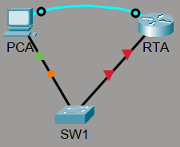

# Configure Secure Passwords and SSH
## 📄Description
In this lab, basic security settings were configured on router RTA and switch SW1. Password encryption, local user authentication, and SSH were used to protect network devices from unauthorized access. Unused switch ports were disabled, and login protection was configured to prevent repeated failed login attempts. SSH connections were tested to verify secure remote management.
## 📌Objectives
✔ Configure basic security settings on a router and a switch  
✔ Encrypt passwords and set password requirements   
✔ Configure SSH for secure remote access  
✔ Disable unused switch ports  
✔ Configure login protection and session timeout  
✔ Verify SSH connectivity to network devices  
## 🌐Network Topology

## 📋Addressing Table

## 🖥️PC Configuration

## ⚙️Router and switch configuration
<h3><b>Router RTA </b></h3>

The router was configured with basic security settings. Password encryption was enabled, and a minimum password length was set to 10 characters. A strong enable secret was configured, and DNS lookup was disabled. A domain name and local user account were created for authentication. RSA keys were generated to enable SSH access. Login protection was configured to block login attempts after repeated failures, and the session timeout was set to 6 minutes.  

<h3><b>Switch SW1 </b></h3>

The switch was configured with a management IP address, default gateway, and basic security settings. Password encryption and local user authentication were enabled. RSA keys were generated, and SSH was configured for secure remote access. Unused switch ports were disabled, and the session timeout was set to 6 minutes.  

## 🧪Testing
SSH connections were tested from PC-A to RTA and SW1 using the configured local username and password.  

Successful SSH connections confirmed that secure remote access was configured correctly.

## 🛠️Troubleshooting 
During configuration, the following settings were checked:  
🔴 Correct IP addresses and default gateway  
🔴 Router and switch interfaces were enabled  
🔴 RSA keys were generated  
🔴 SSH was allowed on VTY lines  
🔴 Local user authentication was configured  
🔴 Unused switch ports were disabled  

## 📚What I Learned
<b>During this lab I practiced:</b> 
➜ How to secure Cisco network devices  
➜ How password encryption works in Cisco IOS  
➜ How to configure local user authentication  
➜ How to generate RSA keys for SSH  
➜ How SSH provides secure remote access  
➜ How to disable unused switch ports  
➜ How to configure login protection and session timeouts  
